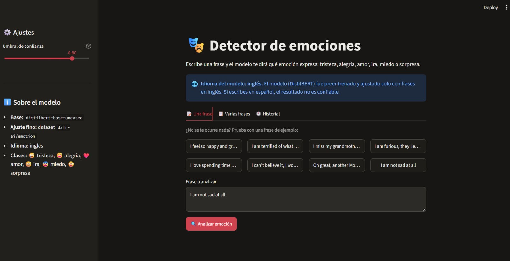
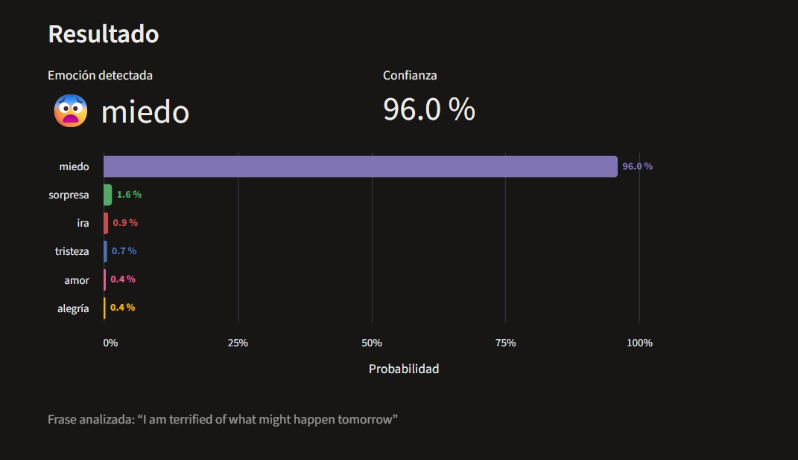
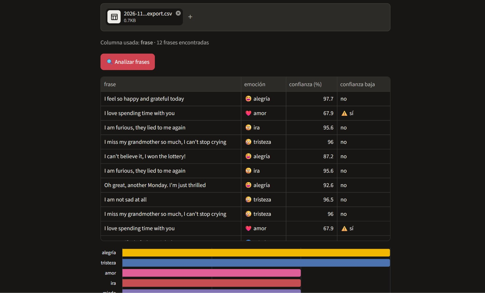
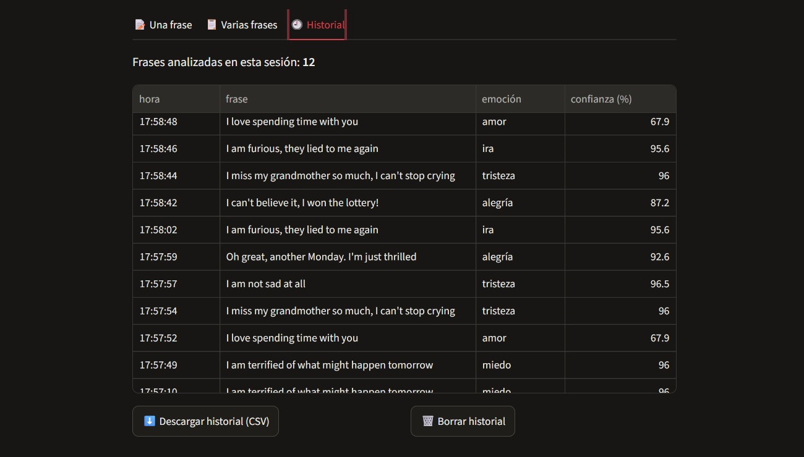

# 🎭 Detector de Emociones con DistilBERT y Streamlit

## 1. Descripción del proyecto

El **Detector de Emociones** es una aplicación web desarrollada con Python y Streamlit que permite identificar la emoción expresada en una frase mediante técnicas de procesamiento de lenguaje natural y aprendizaje automático.

La aplicación utiliza un modelo **DistilBERT ajustado mediante Fine-tuning** durante las actividades de clase. El modelo fue entrenado con el conjunto de datos `dair-ai/emotion`, compuesto por frases en inglés clasificadas en seis categorías:

- 😢 Tristeza (_Sadness_).
- 😄 Alegría (_Joy_).
- ❤️ Amor (_Love_).
- 😠 Ira (_Anger_).
- 😨 Miedo (_Fear_).
- 😲 Sorpresa (_Surprise_).

El usuario puede ingresar una frase individual o analizar varias frases simultáneamente. La aplicación muestra la emoción detectada, su probabilidad en porcentaje y un gráfico con la distribución de probabilidades de las seis categorías.

El modelo fue ajustado por el equipo y guardado localmente para integrarlo en la aplicación, sin necesidad de realizar nuevamente el entrenamiento cada vez que se ejecuta.

## 2. Tecnologías utilizadas

| Tecnología                | Uso                                           |
| ------------------------- | --------------------------------------------- |
| Python                    | Lenguaje de programación principal.           |
| Streamlit                 | Desarrollo de la interfaz web.                |
| PyTorch                   | Ejecución del modelo de aprendizaje profundo. |
| Hugging Face Transformers | Carga y utilización de DistilBERT.            |
| DistilBERT                | Clasificación de emociones en textos.         |
| Pandas                    | Procesamiento y organización de resultados.   |
| Altair                    | Generación de gráficos.                       |

## 3. Entrenamiento del modelo

Se utilizó el modelo base `distilbert-base-uncased`, preentrenado en inglés, y se realizó un proceso de Fine-tuning para adaptarlo a la clasificación de seis emociones.

El conjunto de datos utilizado fue `dair-ai/emotion`. Para el entrenamiento se seleccionaron 4.000 frases, mientras que se utilizaron 2.000 para validación y 2.000 para las pruebas finales.

Los principales parámetros utilizados fueron:

- Modelo base: `distilbert-base-uncased`.
- Learning rate: `2e-5`.
- Batch size: 16.
- Número de épocas: 3.
- Weight decay: 0.01.
- Longitud máxima de tokenización: 64 tokens.
- Entorno de entrenamiento: Google Colab con GPU Tesla T4.

En la evaluación final sobre el conjunto de prueba se obtuvo:

| Métrica  | Resultado |
| -------- | --------: |
| Accuracy |   90,45 % |
| F1-macro |    0,8429 |

Estos resultados permitieron comprobar que el modelo ajustado puede clasificar las seis emociones con un buen rendimiento en el conjunto de prueba.

## 4. Estructura del proyecto

El proyecto está organizado en módulos para separar la interfaz, la lógica del modelo y el procesamiento de información.

```text
detector_emociones/
│
├── app.py
├── requirements.txt
├── README.md
├── .gitignore
│
└── detector/
    ├── __init__.py
    ├── config.py
    ├── modelo.py
    ├── estado.py
    ├── graficos.py
    ├── utilidades.py
    │
    └── vistas/
        ├── __init__.py
        ├── encabezado.py
        ├── barra_lateral.py
        ├── tab_frase.py
        ├── tab_lote.py
        └── tab_historial.py
```

Las capturas de pantalla están en `capturas/`. La carpeta `modelo_emociones_distilbert/` no se incluye en este repositorio porque sus pesos superan el límite de tamaño por archivo de GitHub; se debe obtener por separado para ejecutar las predicciones.

**Descripción de los archivos principales:**

- **app.py:** punto de entrada de la aplicación. Configura la página y organiza las tres pestañas principales.
- **config.py:** contiene las configuraciones generales, como la ruta del modelo, el idioma, las emociones y los límites de procesamiento.
- **modelo.py:** carga el modelo mediante Transformers y realiza las predicciones.
- **estado.py:** administra los datos de la sesión y el historial de consultas mediante `st.session_state`.
- **graficos.py:** construye los gráficos de probabilidades y distribución de emociones utilizando Altair.
- **utilidades.py:** contiene funciones auxiliares para procesar frases, leer archivos CSV y exportar resultados.
- **vistas/:** contiene los módulos encargados de construir cada sección de la interfaz.

## 5. Instalación y ejecución

### Requisitos previos

- Python 3.10 o superior.
- Git (opcional, para clonar el repositorio).
- Los archivos del modelo ajustado `modelo_emociones_distilbert`.

### Paso 1. Descargar el proyecto

```bash
git clone https://github.com/Netodiego/detector-emociones-distilbert.git
```

También se puede descargar el repositorio como ZIP desde GitHub y extraerlo en una carpeta local.

### Paso 2. Ingresar a la carpeta del proyecto

```bash
cd detector_emociones
```

### Paso 3. Crear un entorno virtual

En Windows:

```bash
python -m venv venv
```

Activar el entorno virtual:

```bash
venv\Scripts\activate
```

### Paso 4. Instalar las dependencias

```bash
pip install -r requirements.txt
```

Este archivo contiene las bibliotecas necesarias para ejecutar la aplicación.

### Paso 5. Agregar el modelo entrenado

Obtener la carpeta `modelo_emociones_distilbert` generada durante el entrenamiento y colocarla en el mismo nivel que `app.py`.

La carpeta debe contener, entre otros archivos, `config.json`, `model.safetensors` y los archivos del tokenizador.

**Importante:** el código y las capturas sí están incluidos en GitHub, pero los pesos del modelo (aproximadamente 250 MB) se excluyen del repositorio. Sin esa carpeta, la aplicación mostrará un aviso y no podrá realizar predicciones.

### Paso 6. Ejecutar la aplicación

```bash
streamlit run app.py
```

Streamlit iniciará un servidor local y mostrará la dirección para abrir la aplicación en el navegador, normalmente:

```text
http://localhost:8501
```

## 6. Funcionalidades implementadas

La aplicación incluye los requisitos obligatorios y cuatro funcionalidades adicionales.

### Funcionalidades obligatorias

**1. Entrada de texto**

Permite escribir una frase en un campo de texto y ejecutar su clasificación mediante el botón de análisis.

**2. Resultado principal**

Muestra la emoción identificada y su probabilidad en porcentaje.

**3. Probabilidades de las seis emociones**

Presenta un gráfico de barras con las probabilidades obtenidas para cada categoría.

**4. Carga eficiente del modelo**

Utiliza `@st.cache_resource` para cargar y reutilizar el modelo durante la ejecución de la aplicación, evitando cargarlo nuevamente en cada interacción.

**5. Validaciones**

Muestra mensajes cuando el usuario intenta analizar una frase vacía o cuando no se encuentra la carpeta del modelo.

**6. Aviso de idioma**

Informa que el modelo fue entrenado en inglés y advierte que las predicciones de frases en español no son confiables.

### Funcionalidades adicionales

**1. Umbral de confianza**

Incorpora un control deslizante para modificar el porcentaje mínimo de confianza esperado. Cuando la probabilidad de la emoción principal es inferior al umbral seleccionado, se muestra una advertencia.

**2. Análisis por lotes**

Permite ingresar varias frases, una por línea, o cargar un archivo CSV. Genera una tabla con las predicciones y un gráfico con la distribución de emociones. También permite descargar los resultados en formato CSV. Se establece un límite de 500 frases por operación.

**3. Historial de consultas**

Almacena las frases analizadas durante la sesión, junto con la emoción detectada, el porcentaje de confianza y la hora de consulta. Permite descargar el historial en CSV o eliminar los registros.

**4. Frases de ejemplo**

Incluye botones con frases de prueba para facilitar el uso de la aplicación y comprobar el comportamiento del clasificador.

## 7. Capturas de pantalla de la aplicación

En esta sección se presentan las capturas de pantalla incluidas en `capturas/`.

### Figura 1. Pantalla principal y análisis de una frase

Muestra la interfaz principal, el aviso sobre el idioma del modelo y el campo para ingresar una frase.



### Figura 2. Resultado y probabilidades de predicción

Presenta la emoción detectada, su confianza y las probabilidades de las seis emociones.



### Figura 3. Análisis por lotes

Muestra el procesamiento de varias frases, la tabla de resultados y la distribución de emociones.



### Figura 4. Historial de consultas

Presenta el historial de frases analizadas y las opciones de descarga y eliminación.




## 8. Análisis de errores y limitaciones del modelo

Durante las pruebas identificamos que el modelo presenta dificultades en determinados tipos de frases, aunque obtuvo una accuracy del 90,45 % y un F1-macro de 0,8429 en el conjunto de prueba.

**Frases con sarcasmo:** el modelo puede interpretar literalmente palabras positivas sin reconocer que la intención real de la oración es negativa. Por ejemplo, en la frase _"Oh great, another Monday. I'm just thrilled"_, la expresión parece transmitir alegría, pero realmente representa sarcasmo. El modelo la clasifica como alegría.

**Frases con negaciones:** también presenta dificultades cuando una palabra emocional aparece acompañada de una negación. Por ejemplo, en _"I am not sad at all"_, el modelo identifica tristeza, aunque la frase expresa que la persona no está triste. Esto ocurre porque puede dar demasiado peso a las palabras emocionales sin interpretar correctamente el efecto de la negación.

**Frases ambiguas o con emociones mezcladas:** cuando una oración expresa más de una emoción, el modelo debe seleccionar una sola categoría principal. Esto puede provocar que clasifique incorrectamente la intención general de la frase o que presente probabilidades distribuidas entre varias emociones.

**Frases en español:** el modelo fue preentrenado y ajustado con textos en inglés. Por esta razón, cuando se ingresan frases en español, no se puede garantizar que interprete correctamente su significado.

**Categorías con menos ejemplos:** en la evaluación por categorías, sorpresa obtuvo el menor F1-score, con 0,625, y un recall de 0,530. En el conjunto de prueba esta categoría tenía solamente 66 ejemplos, mientras que alegría tenía 695. La menor cantidad de ejemplos puede dificultar que el modelo aprenda suficientes patrones para reconocer esta emoción.

En conclusión, los errores muestran que el modelo tiene limitaciones para interpretar el contexto, las negaciones, el sarcasmo y las expresiones que no se parecen a los ejemplos utilizados durante el entrenamiento. Para mejorar estos resultados sería conveniente ampliar y equilibrar el conjunto de datos, incorporar ejemplos de expresiones más complejas y entrenar una versión específica para el idioma español.

## 9. Declaración de uso de IA

## Declaración de uso de IA

**Herramientas:** Claude (Anthropic).

**Uso:** apoyo para el desarrollo y organización de la aplicación en módulos y para la celda que guarda y descarga el modelo en el notebook.

**Verificación:** ejecutamos el notebook y la aplicación, y probamos los resultados con distintas frases.
